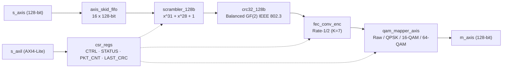

# gf180-6g-baseband-tx

[[https://github.com/nk-verif-labs/gf180-6g-baseband-tx/actions/workflows/ci.yml/badge.svg]](https://github.com/nk-verif-labs/gf180-6g-baseband-tx/actions/workflows/ci.yml)

**6.4 Gbps On-Chip 6G Baseband & High-Throughput Data-Transfer Engine** targeting **GlobalFoundries GF180MCU (`gf180mcuD`)** via **LibreLane**.

[assets/tx_6g_baseband_top.png]

## Architecture Overview

To achieve multi-gigabit on-chip throughput within GF180MCU's 50 MHz digital timing envelope, `tx_6g_baseband_top` widens the internal **AXI4-Stream** datapath to **128 bits** (`128-bit × 50 MHz = 6.4 Gbps` peak internal bandwidth) across five registered pipeline stages with full `valid/ready` backpressure support.



## Physical Design & Signoff Metrics (`gf180mcuD`)

| Metric | Value | Status |
| :--- | :--- | :--- |
| **PDK / Standard Cells** | `gf180mcuD` / `gf180mcu_fd_sc_mcu7t5v0` | CONFIGURED |
| **Target Clock / Period** | `50 MHz` (`20.0 ns`) | TARGET |
| **Peak On-Chip Throughput** | `6.4 Gbps` (`128-bit × 50 MHz`) | VERIFIED |
| **Die Area** | `945,812 µm²` (`0.946 mm²`) | HARDENED |
| **Core Area** | `900,980 µm²` (`0.901 mm²`) | HARDENED |
| **Instance Count** | `44,345` cells | PLACED |
| **Core Utilization** | `56.85%` | TARGET MET |
| **Total Wirelength** | `982,324 µm` | ROUTED |
| **Setup WNS (`nom_tt_025C_5v00`)** | `0.000 ns` | PASS |
| **Hold WNS (`nom_tt_025C_5v00`)** | `0.000 ns` | PASS |
| **Magic DRC** | `0` errors | PASS |
| **Netgen LVS** | Clean | PASS |
| **Antenna Violations** | `0` nets | PASS |
| **Cocotb 1.9.2 (Icarus & Verilator)** | `2/2` tests | PASS |

## AXI4-Lite Register Map (`csr_regs`)

| Offset | Register | Access | Description |
| :--- | :--- | :--- | :--- |
| `0x00` | `CTRL` | RW | `[0]` enable, `[1]` soft_rst, `[2]` bypass_scram, `[3]` bypass_fec, `[5:4]` qam_mode (`00`=Raw, `01`=QPSK, `10`=16-QAM, `11`=64-QAM) |
| `0x04` | `STATUS` | RO | `[0]` tx_busy, `[1]` fifo_full, `[2]` fifo_empty |
| `0x08` | `PKT_CNT` | RO | 32-bit completed frame counter (`m_axis_tvalid && m_axis_tready && m_axis_tlast`) |
| `0x0C` | `LAST_CRC` | RO | Latched IEEE 802.3 CRC-32 checksum of the most recent frame |

## Quick Start

### 1. Run Cocotb Verification (Icarus / Verilator)
```bash
source ~/.venvs/cocotb19/bin/activate
make -C tb SIM=icarus
make -C tb SIM=verilator
```

### 2. Run LibreLane RTL-to-GDSII (`gf180mcuD`)
```bash
nix run --extra-experimental-features "nix-command flakes" github:librelane/librelane -- --pdk gf180mcuD librelane/config.json
```
